<p align="center">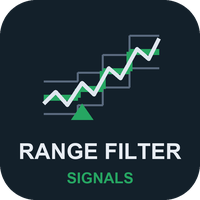</p>

# Range Filter Signals (MetaTrader 5 and MetaTrader 4)

A free range-filter indicator that draws a trend line which moves only when price travels further than a smoothed average
range, two optional bands, and one buy or sell arrow per turn, **on closed bars only**, with an alert for each arrow. Source
for both editions, a Python reference of the maths, and the tests that were used to check that the MT5 and MT4 code, the
Python reference and each other all agree.

**Website:** [allanninal.dev/mql5 (indicators)](https://www.allanninal.dev/mql5/#indicators) · [MT4 editions](https://www.allanninal.dev/mql5/#mt4) · [allanninal.dev](https://www.allanninal.dev)
· **Contact:** message me on [LinkedIn](https://www.linkedin.com/in/allanninal/).

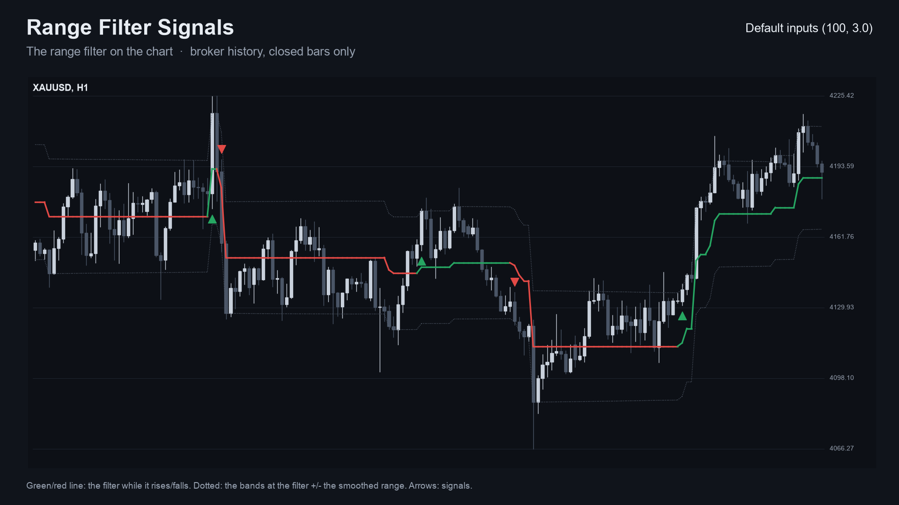

> It is an indicator, not a strategy. It draws a line, bands and arrows and places no trades. Nothing here is a profit
> claim (see [Honest limits](#honest-limits)).

## Get it on the MQL5 Market

| Edition | Platform | Price | Link |
|---|---|---|---|
| Range Filter Signals | MT5 | free | <https://www.mql5.com/en/market/product/201871> |
| Range Filter Signals MT4 | MT4 | free | <https://www.mql5.com/en/market/product/202329> |
| Range Filter Scanner MT5 | MT5 | paid | <https://www.mql5.com/en/market/product/201873> |
| Range Filter Scanner MT4 | MT4 | paid | <https://www.mql5.com/en/market/product/202402> |

The Market builds are the same calculation as the source in this repository. The two scanner editions are a separate,
paid product that is **not** part of this repository (see [Free vs Pro](#free-vs-pro)).

## Contents

1. [What it is and who it is for](#what-it-is-and-who-it-is-for)
2. [Why it was built](#why-it-was-built)
3. [How it works](#how-it-works)
4. [Non-repainting: the proof and how it was tested](#non-repainting-the-proof-and-how-it-was-tested)
5. [Architecture and buffers](#architecture-and-buffers)
6. [Inputs, alerts, install and compile](#inputs-alerts-install-and-compile)
7. [Run the Python reference and the tests](#run-the-python-reference-and-the-tests)
8. [Honest limits](#honest-limits)
9. [Free vs Pro](#free-vs-pro)
10. [Licence and credits](#licence-and-credits)

## What it is and who it is for

**What:** the "range filter" method as a native MetaTrader indicator. The line follows the close only when the close moves
further than a range away from it: a close above the line pulls the line up to `close - range` (never down), a close below
pulls it down to `close + range` (never up), and smaller moves leave it flat. The range is the average size of a
bar-to-bar close change, smoothed twice and multiplied. When a buy setup follows a sell setup (or the reverse) you get an
arrow (buy below the candle, sell above) and an alert (pop-up, sound, push, e-mail).

**For:** traders who want a trend line that ignores small noise, on any symbol and timeframe, and who want to know that the
arrow they saw will still be there tomorrow. Also for developers who want a small, tested indicator with documented
buffers to read from an EA with `iCustom`.

**Not for:** anyone who expects arrows to predict direction. They mark where a close moved further than a volatility-scaled
range from the line.

| | |
|---|---|
| 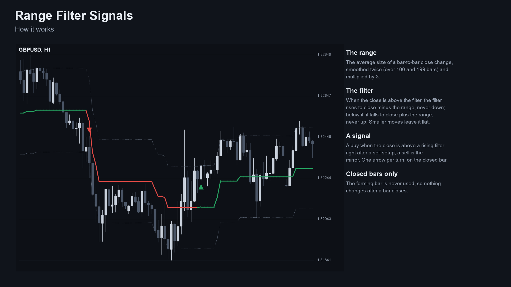 | 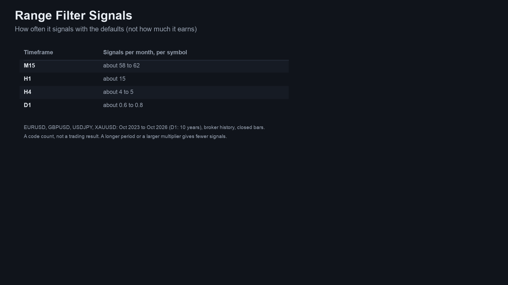 |
| 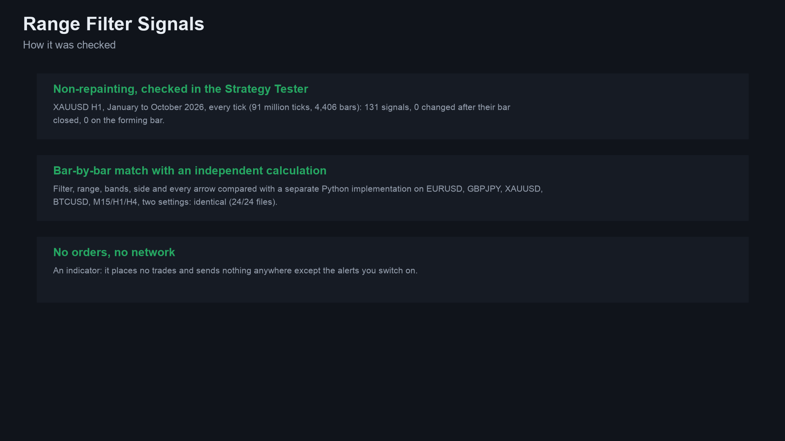 | 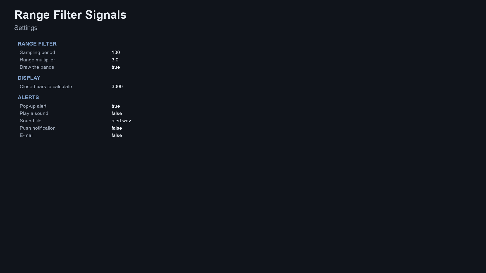 |

Image notes: the charts are drawn by the Python reference on broker history (the same numbers the indicator shows). They
are illustrations, not terminal captures. MT4 versions are in [`docs/images/mt4/`](docs/images/mt4).

## Why it was built

The Range Filter is one of the most-liked trend scripts on TradingView, and traders who move to MetaTrader ask for it. The
motivations, stated with the evidence we actually have:

- **A native, readable port.** The method is a few lines of arithmetic and does not need a closed-source box.
- **A gap in the free tier.** Our market research (October 2026) found large interest on TradingView (the original script
  and its variants have thousands of likes), only two paid range-filter indicators on the MQL5 Market (each with no
  reviews at the time) and no free one.
- **Trust in the arrows.** The same research found repeated complaints about arrow indicators that repaint, and a 2026-07
  request for "arrows confirmed on bar close". The design rule follows: an arrow is only drawn on a bar that has closed,
  and never moves afterwards.
- **Honest scale of demand.** Named classic indicators are requested only rarely by name on forums and freelance boards
  (about one Reddit post mentioning Range Filter in the scan). So this is a free tool that gives a clean reference
  implementation and builds a track record, not a claim of mass demand.
- **Provable behaviour.** Every number in this README comes from an executed check, listed below, not from a promise.

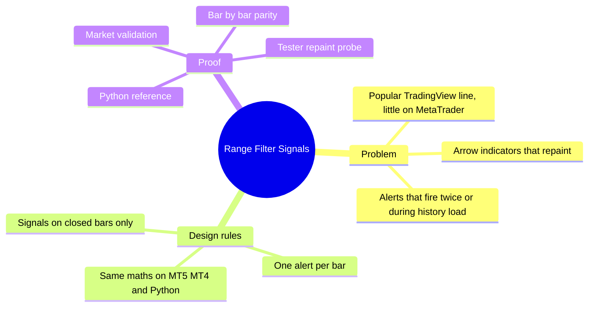

## How it works

### The maths, step by step

Let `C[k]` be the close of the `k`-th bar fed to the engine (oldest = 0), `p` the sampling period and `m` the multiplier.

1. **Average change** `d[k] = |C[k] - C[k-1]|` for `k >= 1`, smoothed with an EMA of period `p`:
   `avrng[k] = avrng[k-1] + 2/(p+1) * (d[k] - avrng[k-1])`, seeded with the first `d`.

2. **Smoothed range** an EMA of `avrng` with period `2p - 1`:
   `smrng[k] = smrng[k-1] + 2/(2p) * (avrng[k] - smrng[k-1])`, seeded with the first `avrng`. Then `r[k] = smrng[k] * m`.

3. **Filter** `f[k]`: it starts at the first close that has a range (`f = C[1]`). After that:

   - if `C[k] > f[k-1]`: `f[k] = max(f[k-1], C[k] - r[k])` (it only rises)
   - otherwise: `f[k] = min(f[k-1], C[k] + r[k])` (it only falls)

   so it moves only when price travels more than `r` away from it. The **bands** are `f +/- r`.

4. **Run counters**: `up` counts bars in a row the filter has risen, `down` bars in a row it has fallen; an unchanged
   filter keeps both. The trend **side** is `+1` while `up > 0`, `-1` while `down > 0`.

5. **Setups**: a buy setup is `C[k] > f[k]`, `C[k] != C[k-1]` and `up > 0`; a sell setup is `C[k] < f[k]`, `C[k] != C[k-1]`
   and `down > 0`. The engine remembers the last setup (`cond`: buy, sell or none).

6. **Signal** (closed bars only): a buy arrow when a buy setup arrives while the last setup was a sell; a sell arrow when
   a sell setup arrives while the last was a buy. The first setup after the start gives no arrow. One arrow per turn.

The engine is fed closed bars only, in order, starting `InpHistory` bars before the last closed bar; the forming bar is
never fed, so the line and the arrows on closed bars never change.

### Per-bar algorithm

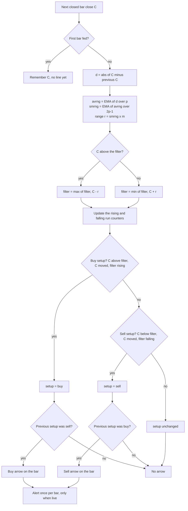

### Signal states

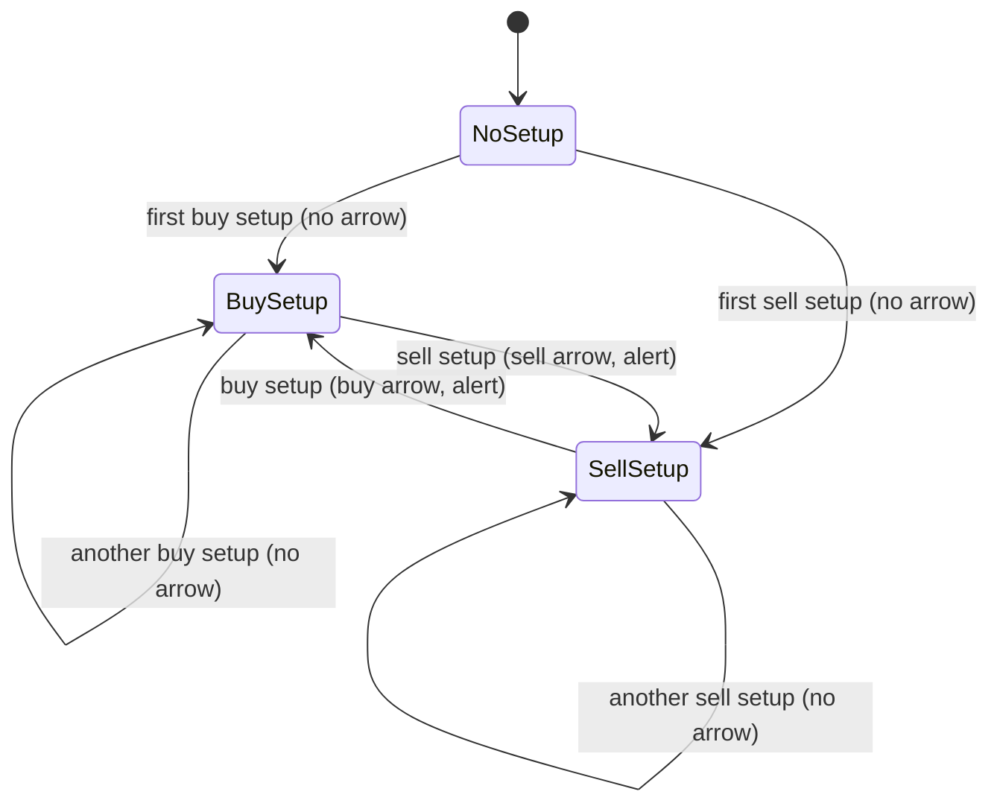

### Alert flow

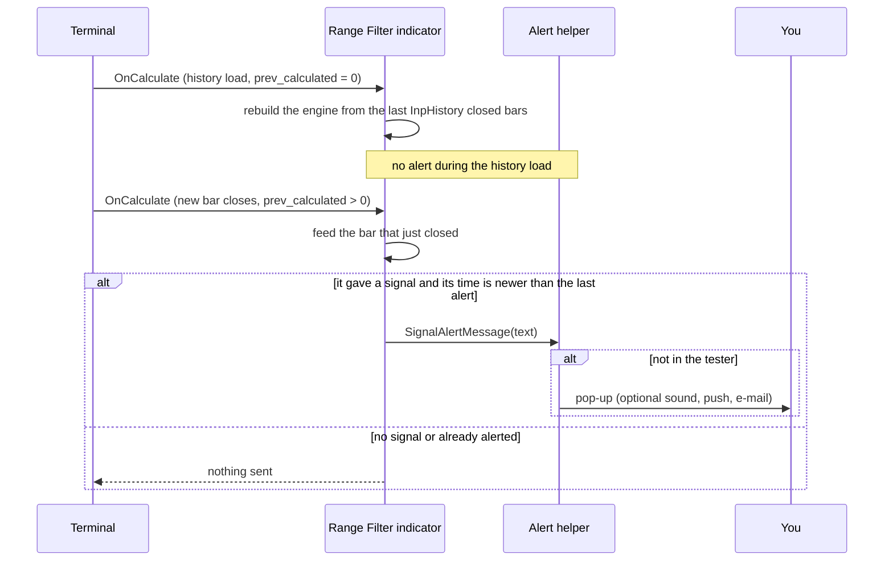

### How often it signals (measured)

Signals (buy plus sell) per month with the default inputs (period 100, multiplier 3.0), on closed bars of broker history,
October 2023 to October 2026 (D1: ten years). Source: [`docs/data/arrows-per-month.json`](docs/data/arrows-per-month.json).
This counts arrows only. It says nothing about profit.

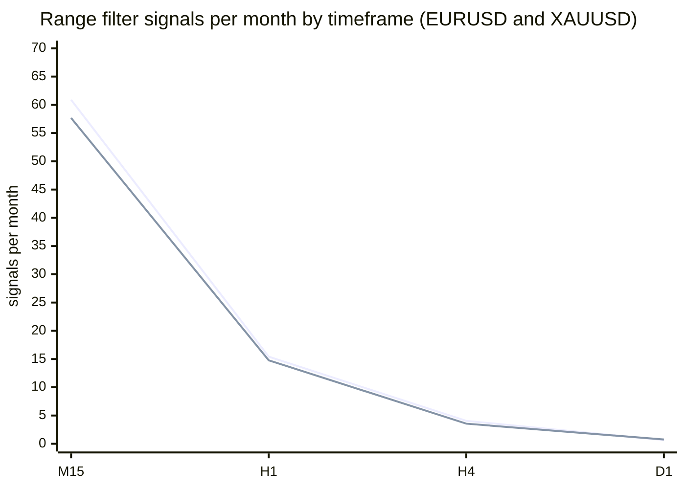

First line EURUSD, second XAUUSD.

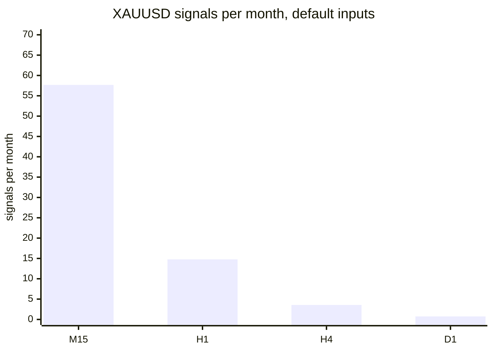

## Non-repainting: the proof and how it was tested

"Non-repainting" is easy to claim. Here is what was actually run. Raw result files are in [`tests/results/`](tests/results).

**1. Three implementations, compared bar by bar.** The Python reference
([`tests/reference.py`](tests/reference.py)) is a separate implementation of the same maths. The MT5 and MT4 indicators
were dumped bar by bar (arrows, filter, bands, side, range, setup state) in the MetaTrader Strategy Tester, and
[`tests/check_parity.py`](tests/check_parity.py) compared each dump with the reference. Pass means: filter, range and
bands within 1e-9 relative, side and setup identical, and arrows on exactly the same bars.

| | MT5 | MT4 |
|---|---|---|
| dumps compared | 24 (4 symbols x M15/H1/H4 x 2 input sets) | 25 (same 24 + one every-tick EURUSD H1) |
| bars compared | 72,000 | 514,102 |
| arrows compared (buy + sell) | 3,072 | 21,437 |
| result | ALL PASS | ALL PASS |

Symbols: EURUSD, XAUUSD, GBPJPY, BTCUSD. Input sets: defaults (period 100, multiplier 3.0); period 20, multiplier 2.0.
The tests below were re-run on exactly the code in this repository. Source: [`tests/results/parity-mt5-and-mt4.txt`](tests/results/parity-mt5-and-mt4.txt). The MT5 dumps cover the indicator's
default window of 3,000 closed bars each, which is why the MT5 bar count is much smaller than the MT4 one (the MT4
test calculates the whole test history).

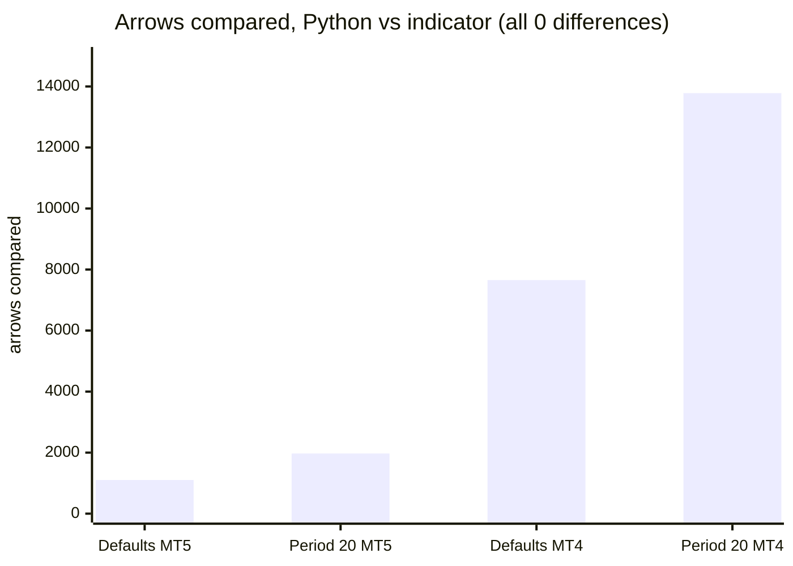

(MT4 "Defaults" is 7,479 arrows over 12 runs plus 176 in the every-tick run = 7,655.)

**2. Repaint probe.** An EA records which signal buffers are set on each bar *at the moment it closes*, then reads the same
bars again at the end and counts any value that changed. It also counts any signal ever shown on the still-forming bar.

| Run | Closed bars checked | Signals seen at close | Changed afterwards | Signals on the live bar |
|---|---|---|---|---|
| MT5, XAUUSD H1, every tick, 91,052,717 ticks | 4,406 | 131 | **0** | **0** |
| MT4, 25 runs combined | 505,320 | 21,079 | **0** | **0** |

Source: [`tests/results/repaint-summary.md`](tests/results/repaint-summary.md). The MT5 repaint probe was run once (XAUUSD
H1, default inputs); the MT4 probe ran on every dump run.

**3. Market validation.** Both Market builds passed the MQL5 Market's automated product validation before publication
(this is the Market's own check, not part of this repository).

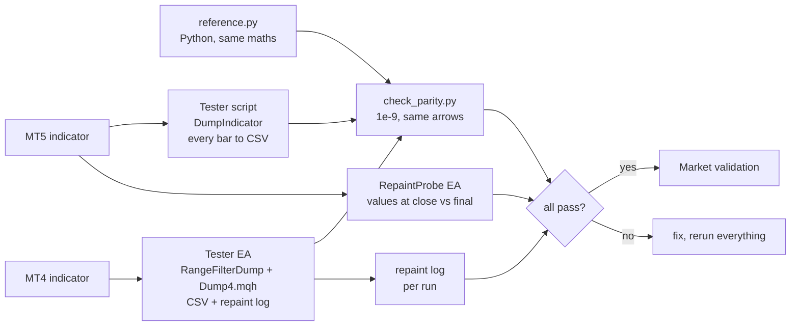

### Why the design cannot repaint

- The engine is fed closed bars only: the loop stops at `rates_total - 2`, so the forming bar is never used.
- Each step depends only on the previous state and the new close (recursive formulas, no look-ahead).
- Alerts fire only for the bar that just closed, only after the history load, once per bar, and never in the tester.
- The MT4 tester recalculates an indicator from scratch at the end of a run, and a fresh calculation covers only the last
  `InpHistory` bars; the MT4 test therefore stores each bar's values as the live instance produced them and compares those.

## Architecture and buffers

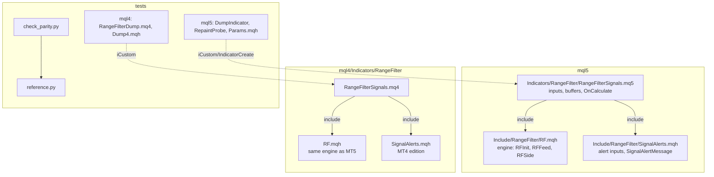

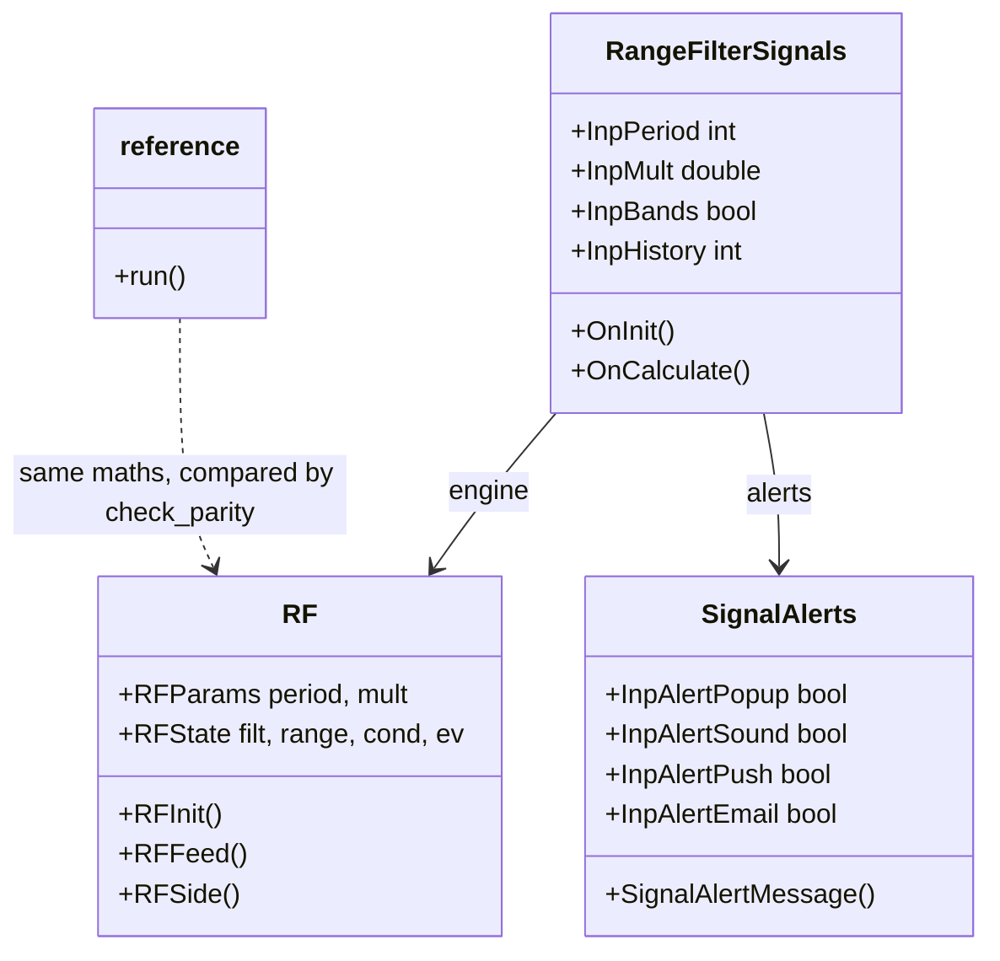

### `iCustom` buffer table (for EA developers)

| Buffer | MT5 | MT4 |
|---|---|---|
| 0 | **Buy** arrow price (bar low), empty otherwise | **Buy** arrow price, empty otherwise |
| 1 | **Sell** arrow price (bar high), empty otherwise | **Sell** arrow price, empty otherwise |
| 2 | range filter line | range filter line |
| 3 | colour index of the line (0 rising, 1 falling, 2 flat) | rising part of the drawn line |
| 4 | upper band | upper band |
| 5 | lower band | lower band |
| 6 | trend side (+1, -1, 0) | trend side |
| 7 | range `r` | range `r` |
| 8 | last setup (+1 buy, -1 sell, 0 none) | last setup |
| 9-10 | not used | falling part and flat part of the drawn line |

Empty value is `EMPTY_VALUE`. Read arrows on **closed bars** (shift 1 and higher). `iCustom` parameters follow the input
order: sampling period, range multiplier, draw the bands, closed bars to calculate, arrow gap (MT4 only), pop-up, sound,
sound file, push, e-mail. In MT5 the `input group` headings also count as string parameters when you build a handle with
`IndicatorCreate` (see `tests/mql5/Include/IndTest/Params.mqh`).

## Inputs, alerts, install and compile

| Input | Default | Meaning |
|---|---|---|
| Sampling period | 100 | Smoothing length of the average range (2 to 1000) |
| Range multiplier | 3.0 | Scales the range. Larger: fewer, later signals |
| Draw the bands | true | Show or hide the two dotted bands |
| Closed bars to calculate | 3000 | How much history is calculated (300 to 50000) |
| Arrow distance from the candle (MT4 only) | 0.3 x ATR(14) | Gap between arrow and candle (MT5 uses a fixed pixel gap) |
| Pop-up alert | true | Terminal alert window |
| Play a sound / sound file | false / alert.wav | File from the terminal's Sounds folder |
| Push notification | false | Needs your MetaQuotes ID in Options |
| E-mail | false | Needs e-mail set up in Options |

**Alert text:** `Range Filter Signals: BUY on EURUSD H1 at 1.08512`.

**Install from source.** MT5: copy `mql5/Indicators/RangeFilter/` into `<terminal data folder>/MQL5/Indicators/` **and**
`mql5/Include/RangeFilter/` into `<data folder>/MQL5/Include/`, open `RangeFilterSignals.mq5` in MetaEditor and press
Compile (F7). MT4: copy `mql4/Indicators/RangeFilter/` into `<data folder>/MQL4/Indicators/` (the three files of the
edition stay together) and compile `RangeFilterSignals.mq4`. Both compile with 0 errors and 0 warnings (checked on a
Windows machine with MetaEditor; the compiled files are not in the repository).

## Run the Python reference and the tests

```bash
python3 -m venv .venv && . .venv/bin/activate && pip install -r requirements.txt
```

```python
import sys; sys.path.insert(0, "tests")
from reference import run
# c is a list of closing prices of closed bars, oldest first
rows = run(c, period=100, mult=3.0)   # per bar: filt, range, up, dn, cond, ev (+1 buy, -1 sell), side
```

To repeat the parity check on your own data:

1. Compile the indicator and the test tool for your platform (`tests/mql5/Scripts/DumpIndicator`, or `tests/mql4/RangeFilterDump.mq4`
   with `tests/mql4/Include/IndTest4/Dump4.mqh` in your `MQL4/Include/IndTest4/`; MT5 also needs `tests/mql5/Include/IndTest/Params.mqh`).
2. Run it in the Strategy Tester (MT4) or as a script (MT5) for each symbol and timeframe, with the input sets in
   `tests/configs.tsv` (MT5) / `tests/mql4/configs.tsv` (MT4). The tool writes one CSV per symbol and timeframe.
3. `python3 tests/check_parity.py <folder>` where the CSVs are in `<folder>/dump/` and named `rf_default_*` or
   `rf_p20_m2_*` (add `--mt4` for MT4 dumps). It prints PASS or FAIL per file and an overall result.
4. Repaint: run `tests/mql5/Experts/RepaintProbe` in the MT5 Strategy Tester (every tick); MT4 writes its repaint log with the dump.

The price dumps used for the published numbers are not in this repository (they are broker price data).

## Honest limits

- **An indicator signal is not a strategy.** No stop-loss, position sizing or exit rules are provided or implied, and the
  arrows were not optimised or back-tested for profit. Whether a turn of the filter makes money depends on your market,
  costs and rules.
- **No profit or accuracy claim is made.** The only numbers here are about *consistency* (the three implementations agree,
  signals do not move) and *frequency* (signals per month).
- **Lag is built in.** The filter moves only after price has travelled more than the range away; a longer period or larger
  multiplier gives fewer signals that come later still.
- **Sideways markets** leave the line flat, but a flat line can still produce a turn when price finally breaks away.
- **Window-dependent.** The EMAs are seeded with the first values the engine sees, and the engine starts `Closed bars to
  calculate` bars back, so the first signals of a window can differ from a longer one.
- **Scope of the tests.** Four symbols, three timeframes, two input sets, one MT5 repaint run. Other symbols and
  timeframes are not covered by the published numbers. The MT5 build was not run on a live chart as part of these numbers.
- A multi-symbol scanner that watches these signals across many symbols exists as a separate paid product (see below).

## Free vs Pro

| | Free: Range Filter Signals | Paid: Range Filter Scanner |
|---|---|---|
| Platforms | MT5 [201871](https://www.mql5.com/en/market/product/201871), MT4 [202329](https://www.mql5.com/en/market/product/202329) | MT5 [201873](https://www.mql5.com/en/market/product/201873), MT4 [202402](https://www.mql5.com/en/market/product/202402) |
| Price | free | paid (see the Market page) |
| What you get | Filter line, bands and arrows on the current chart, alerts, source here | A multi-symbol, multi-timeframe scanner of range-filter signals, as described on its Market listing |
| Source | this repository | not published |
| Closed-bar signals, no repaint | yes | see its listing |

No need to buy the paid product to use the free one: the free indicator is complete on its own.
Website: [allanninal.dev/mql5](https://www.allanninal.dev/mql5/#indicators) ([MT4](https://www.allanninal.dev/mql5/#mt4)).
The paid product has a code-free showcase page at [allanninal/range-filter-scanner](https://github.com/allanninal/range-filter-scanner).

## Licence and credits

**Origin of the maths.** The range-filter method is popularised by TradingView open-source scripts, notably **"Range Filter
[DW]"** (the initials in the title are the author's) and its many variants. Thank you to the authors.

**What this means for the licence.** TradingView publishes open-source scripts under the Mozilla Public License 2.0 unless
the author states another licence. I did not check the original script's own header, so I took the conservative route: the
files that implement the range-filter calculation are licensed **MPL-2.0**:

- `mql5/Include/RangeFilter/RF.mqh`
- `mql4/Indicators/RangeFilter/RF.mqh`
- `mql5/Indicators/RangeFilter/RangeFilterSignals.mq5`
- `mql4/Indicators/RangeFilter/RangeFilterSignals.mq4`
- `tests/reference.py`

They are independent implementations in other languages, written from the maths, plus additions (closed-bar signals,
alerts), but treating them as derived from an MPL-2.0 work is the safe reading. MPL-2.0 is file-level: changes to those
files must stay MPL-2.0 and be shared.

Everything else (alert helpers `SignalAlerts.mqh`, test tools, parity checker, docs, images) is © 2026 Allan Niñal under the
[PolyForm Noncommercial License 1.0.0](LICENSES/PolyForm-Noncommercial-1.0.0.md): free for personal and other
noncommercial use, not for commercial use (source-available, not OSI open source). Each source file has an
`SPDX-License-Identifier` line. Texts: [`LICENSE`](LICENSE), [`LICENSES/MPL-2.0.txt`](LICENSES/MPL-2.0.txt). The licence
applies to this source, not to anything you build or trade with the indicator. Trading involves risk; the software is
provided as is.

---

**Website:** [allanninal.dev/mql5](https://www.allanninal.dev/mql5/#indicators) · [MT4](https://www.allanninal.dev/mql5/#mt4) · [allanninal.dev](https://www.allanninal.dev)
· Questions: message me on [LinkedIn](https://www.linkedin.com/in/allanninal/).
